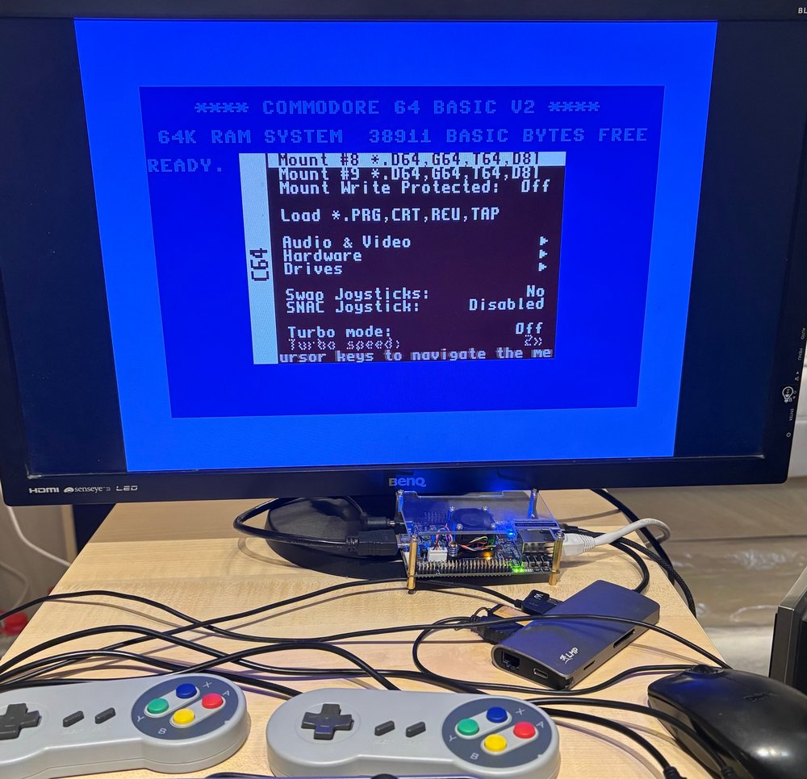
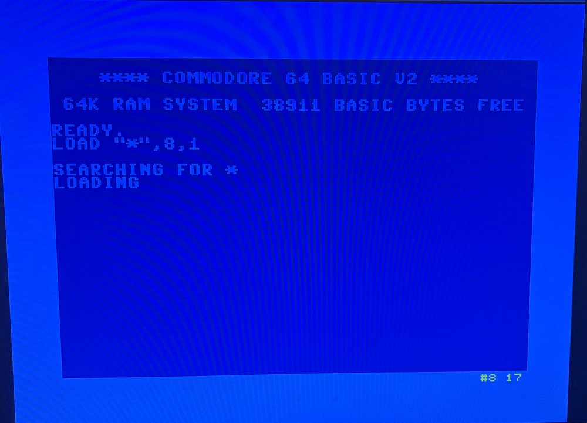
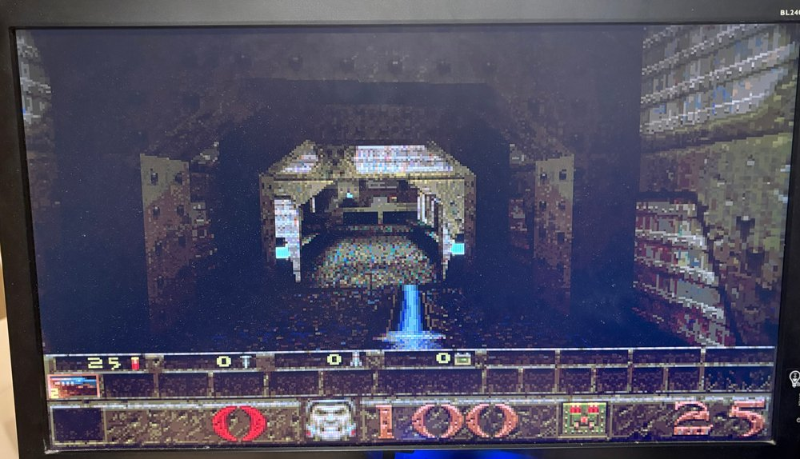

# Retro25 — MiSTer on the Terasic DE25-Nano

Retro25 brings the [MiSTer](https://github.com/MiSTer-devel) framework to the
**Terasic DE25-Nano** (Intel/Altera Agilex 5 E, Arm HPS running Linux). As on
MiSTer, Linux loads different FPGA cores at runtime, selected from the
menu (F12). Ported so far: the `sys/` framework (HDMI, OSD, scaler, audio,
`hps_io`), the Linux program Main_MiSTer (now aarch64) and three
cores: Menu, **C64** and **z486** (486 PC).

> A one-person learning project, not an official MiSTer port. Everything here
> ran on exactly one board; expect rough edges.

## Status (2026-10-22)

| Part | Status |
|---|---|
| HPS-first boot, core switching from Linux (~2 s) | ✔ 30+ switches without errors |
| `sys/`: HDMI (ADV7513), scaler `ascal`, OSD, audio, video modes, DDR via F2SDRAM | ✔ |
| Main_MiSTer (aarch64): menu, USB keyboard/mouse/gamepads, disk images, screenshots | ✔ |
| Menu core, core selection via F12 | ✔ |
| **C64** (C64_MiSTer): BASIC, PRG, D64 read/write, CRT, TAP, SID, joysticks | ✔ → [`cores/c64/README.md`](cores/c64/README.md) |
| **z486** (z486_MiSTer): FreeDOS, Windows 95, Doom, Quake, SVGA, x87, Sound Blaster | ✔ → [`cores/z486/README.md`](cores/z486/README.md) |
| Read-only Linux root (SD card survives hard resets) | ✔ |
| `vsync_adjust=2`, `direct_video`, ALSA output, MIDI | open |

Milestones and decisions: [`docs/roadmap.md`](docs/roadmap.md);
details of the port: [`sys/de25/README.md`](sys/de25/README.md),
[`linux/main/README.md`](linux/main/README.md),
[`linux/system/README.md`](linux/system/README.md).

### How it fits together

```
 Linux (HPS, Cortex-A76/A55)                 FPGA (Agilex 5)
 ┌──────────────────────────┐  LW-Bridge  ┌───────────────────────────────┐
 │ Main_MiSTer (aarch64)    │◄───────────►│ sys/ (same for all cores):    │
 │  menu, input, disks      │ gp_out/gp_in│  HDMI, OSD, scaler, audio,    │
 │  load core via overlay   │             │  hps_io  └─ emu (the core)    │
 └──────────────────────────┘  F2SDRAM ◄──┴───────────────────────────────┘
        ▲ SD card: Linux, cores, games          HPS DDR: scaler, disks
```

Analogy: the board is a game console with swappable cartridges. Linux is the
caretaker who plugs in the cartridges (cores); `sys/` is the ever-identical
connector strip where every cartridge finds screen, sound and keyboard.

Differences from the DE10-Nano MiSTer: the board boots **HPS-first** — the
QSPI flash holds only the I/O ring and bootloader, U-Boot loads the start core
from the SD card, and Linux switches it via a device tree overlay. The SDRAM
(128 MB) is soldered onto the board, and Linux is Terasic's Ubuntu 22.04
instead of MiSTer Linux.

---

## What is not in the repository (and why)

Retro25 itself is licensed under **GPL-3.0-or-later** ([`LICENSE`](LICENSE)).
Not included is everything we may not or should not redistribute:

| Part | Why not | Where from |
|---|---|---|
| MiSTer `sys/`, Main_MiSTer, Menu/C64/MemTest cores | third-party code; partly without per-file license notice | `tools/setup.py` fetches them from fixed commits |
| z486_MiSTer | no license file; microcode explicitly not Apache-2.0 | `tools/setup.py` |
| Terasic GHRD (HPS system, bootloader SPL) | Terasic permits use, not redistribution | Terasic resource package, `tools/fetch_hps.py` |
| C64 and 1541 ROMs | copyrighted | obtain yourself → `roms/` |
| Built bitstreams (`.rbf`, `.jic`) | contain ROMs or the z486 microcode | build yourself |

Instead, the repository contains our own parts (`sys/de25/`, `linux/`,
`tools/`, `tb/`, core wrappers) and the changes to third-party code as
**patches** (`*.patch` in `pro/`) or as text substitutions
(`cores/z486/make_pro.py`). `tools/setup.py` fetches the third-party code into
`vendor/` and generates the adapted copies in `pro/` from it.

---

## Step-by-step installation

These instructions assume a new DE25-Nano and a Windows PC.
Plan an afternoon for the first run (of which ~1 h is the Quartus build).
Commands starting with `>` run in the Windows command prompt, those with `$` on the
board (via SSH or serial console).

### 1. What you need

**Hardware**
- Terasic DE25-Nano with power supply
- microSD card, **at least 16 GB** (tested: 32 GB)
- USB cable to the PC (the onboard USB-Blaster and the serial console share
  the same USB port)
- HDMI monitor, USB keyboard (via USB-C adapter/hub on the USB host port)
- **Network cable** — a USB Wi-Fi stick loses its connection on every core
  switch
- optional: USB gamepad, USB mouse, USB stick for games

**Software on the PC**
- **Quartus Prime Pro 26.1** with *Agilex 5* device support (the free
  Lite/Standard Edition does not support Agilex 5). The installer sets the
  environment variable `QUARTUS_ROOTDIR`; check: `> echo %QUARTUS_ROOTDIR%`.
- **Python 3.10+** and **git** (both in `PATH`)
- **Docker Desktop** (builds Main_MiSTer in an arm64 Ubuntu container)
- a program for writing SD images (balenaEtcher, Win32DiskImager
  or Rufus) and a terminal for the serial console (PuTTY or similar)

**From Terasic** ([terasic.com](https://www.terasic.com.tw) → DE25-Nano →
Resources), two downloads:
- the **Linux SD image** `de25_nano_sdcard_console_v1.1`
  (`de25_nano_revA_sdcard_console_v1.1.img`, Ubuntu 22.04, Linux 6.12)
- the **resource package** ("DE25-Nano resource package", CD contents) — from
  it Retro25 needs the GHRD under `Demonstration\SoC_FPGA\GHRD`

### 2. Get the repository and set up third-party code (PC)

```
> git clone <URL of this repository> C:\Retro25
> cd C:\Retro25
> python tools\setup.py
```

`setup.py` fetches the MiSTer framework, Main_MiSTer, Menu, C64, MemTest and z486
(each at a fixed commit, via `git`), plus the z486 boot ROMs and FreeDOS test disk,
and generates the adapted copies. At the end it lists what is still missing.
`python tools\setup.py --check` lets you check this at any time.

**Short path (important):** Quartus aborts HPS designs in deeply nested
folders after ~40 s (`dni::save_checkpoint … manifest.txt`). Therefore mount the
repository as drive `Q:` and start **all Quartus steps from
`Q:\`**:

```
> subst Q: C:\Retro25
```

`subst` lasts until the next Windows restart; then run it again.

### 3. Generate the HPS system from Terasic's GHRD (PC)

Unpack the resource package, then:

```
> python tools\fetch_hps.py <resource package>\Demonstration\SoC_FPGA\GHRD sys\hps
```

The script copies the HPS system to `sys/hps/` and rebuilds it with
Platform Designer (via `qsys-script`) for Retro25:
- `sys/de25/hps_bridges.tcl` — two Avalon bridges on the LW bridge for
  Main's registers (gp_out/gp_in, PLL, I2C, DDR lock)
- `sys/de25/hps_f2sdram_ports.tcl` — three DDR ports for the scaler and cores
- `sys/de25/hps_slim.tcl` — removes demo and debug parts (room for the z486)

Takes ~5 min. If it ends with "qsys_top neu erzeugt." ("qsys_top regenerated."), all is well.

### 4. Build the cores (PC)

Put the C64 ROMs into `roms/` first (file names in
[`roms/README.md`](roms/README.md)). Then for each core:

```
> python tools\make_core_qsf.py menu
> Q:\tools\build_core.bat menu                 :: ~10 min

> python tools\make_c64_roms.py
> python tools\make_core_qsf.py c64
> Q:\tools\build_core.bat c64                  :: ~15 min

> python tools\make_core_qsf.py z486
> Q:\tools\build_core.bat z486                 :: ~20 min
```

Result: `cores\<core>\quartus\output_files\<core>.core.rbf`.
At the end, `build_core.bat` shows the lines containing "hash" — the **HPS IO hash**
must be identical for all cores (otherwise the core does not match the flash).

Flash file (I/O ring + HPS bootloader) from the menu core:

```
> Q:\tools\make_flash.bat menu                 :: -> menu.hps.jic
```

Main_MiSTer (Docker Desktop must be running; the first build takes ~15 min due to
arm64 emulation):

```
> python tools\build_main.py                   :: -> linux\main\build\MiSTer
```

### 5. Write the SD card and first boot

1. Write `de25_nano_revA_sdcard_console_v1.1.img` to the microSD card with
   balenaEtcher or similar, insert the card into the board.
2. Connect the board to the PC via USB-C. Device Manager shows
   **two** serial ports: one leads into the FPGA, the other is the
   Linux console (`COM11` on the developer's machine; if in doubt, try both).
   Open a terminal: **115200 baud, 8N1**, no flow control.
3. Plug in the network cable, power on the board. Linux boots on the console;
   login **`terasic` / `123`**.
4. Look up the IP address: `$ ip -4 addr show eth0` (or whichever connection
   has an address). From now on everything also works via SSH:
   `> ssh terasic@<board-ip>`.

Tip: so that the board always gets the same address from the router, set a fixed
MAC (connection name from `nmcli con show`):
`$ sudo nmcli con modify "Wired connection 1" 802-3-ethernet.cloned-mac-address <MAC>`
and reserve it in the router.

### 6. Install packages (board)

```
$ sudo apt update
$ sudo apt install device-tree-compiler u-boot-tools libimlib2
```

(`dtc` builds the overlay for loading cores, `mkimage` the U-Boot script;
Main needs `libimlib2` for screenshots and background images.)

### 7. Partition the SD card (board)

Terasic's image has a 300 MB boot partition (FAT) and a 3.4 GB root
(almost full). Retro25 needs:

| Partition | Size | Contents |
|---|---|---|
| `mmcblk0p1` | 300 MB FAT | bootloader, kernel, start core (`retro25/core.rbf`) |
| `mmcblk0p2` | 8 GiB ext4 | Linux, later **read-only** |
| `mmcblk0p3` | rest, ext4, label `retro25data` | `/media/fat`: Main, cores, games, settings |

Why? A reset in the middle of a write destroys a file system. The Linux root
is therefore mounted read-only; everything that changes lives on
its own data partition (like `/media/fat` on MiSTer).

First back up the partition table, then grow root to 8 GiB (start
stays at sector 616449) and append a third partition:

```
$ sudo sfdisk -d /dev/mmcblk0 > ~/mmcblk0-partitionen.txt
$ echo '616449,16777216' | sudo sfdisk --no-reread -N 2 /dev/mmcblk0
$ echo ',,L' | sudo sfdisk --no-reread --append /dev/mmcblk0
$ sudo reboot
```

After the reboot, grow the root file system and create the data partition:

```
$ sudo resize2fs /dev/mmcblk0p2
$ sudo mkfs.ext4 -L retro25data /dev/mmcblk0p3
$ sudo mkdir -p /media/fat && sudo mount /dev/mmcblk0p3 /media/fat
$ sudo mkdir /media/fat/retro25 && sudo chown terasic:terasic /media/fat/retro25
$ ln -s /media/fat/retro25 ~/retro25
$ lsblk                                  # p2 ~8G, p3 = rest
```

`~/retro25` is the working folder for everything coming from the PC; it lives on
the data partition so that it remains writable even with a read-only root.

> These commands are the condensed version of what happened on the developer board in
> two stages (P0: root enlarged, P3a: data partition). If `sfdisk`
> reports that the device is busy, adding `--force` helps. If problems arise:
> rewrite the card and start over — nothing is lost yet.

### 8. Copy files to the board (PC)

```
> scp -r linux\system linux\boot terasic@<board-ip>:~/retro25/
> scp cores\menu\quartus\output_files\menu.core.rbf terasic@<board-ip>:~/retro25/
> scp cores\c64\quartus\output_files\c64.core.rbf terasic@<board-ip>:~/retro25/
> scp cores\z486\quartus\output_files\z486.core.rbf terasic@<board-ip>:~/retro25/
> python tools\build_main.py --deploy terasic@<board-ip>
```

`--deploy` copies Main (`MiSTer`), `install.sh`, `MiSTer.ini` and `board/`
to `~/retro25/`.

### 9. System settings (board)

```
$ cd ~/retro25/system && sudo ./install.sh
$ sudo reboot
```

Afterwards: root is read-only, `/media/fat` = data partition, logs and
journal in RAM, USB sticks appear under `/media/usb0…5`, Magic SysRq enabled.
Check: `$ findmnt /media/fat` shows `/dev/mmcblk0p3`. For maintenance (e.g.
`apt`), make root writable briefly: `sudo retro25-rw` … `sudo retro25-ro`.

### 10. Boot script and flash (board, then PC)

First extend the U-Boot script — from now on it loads the menu core into the
FPGA at power-on and reserves 512 MB of DDR for the FPGA:

```
$ cd ~/retro25
$ sudo bash boot/retro25-bootscr.sh install menu.core.rbf
$ sudo poweroff
```

Then program the QSPI flash (HPS-first):

1. Board **powered off**, switch **SW5 to AS mode**: SW5.1 OFF,
   SW5.2 ON, SW5.3 ON (factory default). Only change SW5 while powered off.
2. Power on the board (USB to the PC connected), then on the PC:
   ```
   > Q:\tools\flash.bat menu
   ```
3. Power the board off and on again.

The serial console now shows `Retro25: lade retro25/core.rbf
ins FPGA` ("loading retro25/core.rbf into the FPGA"), then Linux boots as usual.
Check after logging in:
`$ ls /proc/device-tree/reserved-memory/` shows `retro25_fpga@a0000000`.

> This step was tested with the `.jic` from the P0 experiment
> (`p0\quartus\build_p0.bat`, same HPS system, same HPS IO hash);
> `make_flash.bat` produces the same kind of file from the menu core.

### 11. Set up Main_MiSTer (board)

```
$ cd ~/retro25
$ sudo ./install.sh menu.core.rbf c64.core.rbf z486.core.rbf
```

This sets up: Main under `/media/fat/MiSTer`, `MiSTer.ini`, the menu as
`/media/fat/menu.rbf`, the other cores as `/media/fat/_Retro25/C64.rbf`
and `Z486.rbf`, the overlay for loading cores, and the service **`retro25-main`**,
which runs Main at every boot. The menu appears on the HDMI monitor;
**F12** opens the core selection.

### 12. Games, ROMs and disks

| Core | Where | What |
|---|---|---|
| C64 | `/media/fat/games/C64/` | `.d64`, `.prg`, `.crt`, `.tap` (ROMs are already in the core) |
| z486 | `/media/fat/games/Z486/` | `boot0.rom`, `boot1.rom` (**required**, from `roms\z486\`), `freedos.vhd`, your own `.vhd`/`.img`/`.iso` |

```
> scp roms\z486\boot0.rom roms\z486\boot1.rom roms\z486\freedos.vhd terasic@<board-ip>:/media/fat/games/Z486/
```

USB stick: Main also finds games under `<stick>/games/C64` or
`<stick>/games/Z486` (in that case `boot0.rom`/`boot1.rom` must also be on the
stick). Operation, hard disks, Windows 95, sound: see the core READMEs.

**Done.** Menu core via F12 → C64 or Z486; in the z486,
**Win + F12** opens the OSD (DOS needs F12 by itself).

---

## Troubleshooting — tips and tricks

### First aid

| Symptom | Cause / remedy |
|---|---|
| HDMI stays black after power-on | Is Main running? `systemctl status retro25-main`. Message "FPGA is uninitialized" = no Retro25 core in the FPGA (boot script? flash?). Console: does `Retro25: lade retro25/core.rbf` appear? |
| HDMI black after a hard reset | `/media/fat` was not mounted in time (file system check). Wait, or look at `journalctl -b \| grep media-fat` |
| Linux no longer boots after step 10 | Put the SD card into the PC, copy `boot.scr.uimg.orig` to `boot.scr.uimg` on the FAT partition |
| Flash broken/wrong | can always be rewritten (SW5 AS mode, `flash.bat`); as a last resort Terasic's `golden_top_hps.jic` (comes with the SD image) |
| Core does not load, OSD shows "DDR busy" | The old core did not release the DDR; it stays loaded. Try again, otherwise reboot |
| z486 stays black | `boot0.rom`/`boot1.rom` missing in `games/Z486` — also on a stick with `games/Z486`, since Main then uses the stick |
| Menu shows no cores | In the OSD under System → **Storage**, "USB" was selected; Main then looks for everything on the stick. Set it back to "SD" (or `printf '\0\0\0\0' > /media/fat/config/device.bin` and reload the menu) |
| Keyboard works, gamepad does not | Define the gamepad in the **menu core** first (F12 → System → Define joystick buttons), then in the core |
| Wi-Fi gone after core switch | known issue (USB Wi-Fi stick, driver). Use a network cable |
| Windows 95 checks the disk at startup | Shut down Windows before every core switch or reset |
| New core after `install.sh` is still the old one | Restarting Main does not reload the FPGA → `echo 'load_core /media/fat/_Retro25/Z486.rbf' > /dev/MiSTer_cmd` or via the menu |

### Monitoring and remote-controlling Main

```
$ systemctl status retro25-main
$ journalctl -u retro25-main -f                  # follow output live
$ sudo systemctl stop retro25-main               # start Main manually:
$ sudo /media/fat/MiSTer /media/fat/_Retro25/C64.rbf
```

Main reads commands from the FIFO `/dev/MiSTer_cmd` (no `sudo` needed):

```
$ echo "load_core /media/fat/_Retro25/C64.rbf" > /dev/MiSTer_cmd
$ echo screenshot > /dev/MiSTer_cmd               # PNG in /media/fat/screenshots/<Core>/
```

Screenshots are ideal for sending a picture of the screen to the PC (or
to a helper) via `scp`.

### When Linux hangs: Magic SysRq instead of the reset button

The reset button is a power failure for the SD card. Better via the
serial console: send **BREAK** (PuTTY: right-click the title bar →
Special Command → Break), then press a key within 5 s:

| Key | Effect |
|---|---|
| `w`, `l` | show blocked tasks or backtraces of all CPUs (diagnostics) |
| `s` | write all data to the card (sync) |
| `u` | remount file systems read-only |
| `b` | reboot immediately |

So: BREAK+`s`, BREAK+`u`, BREAK+`b`. Only if even that does not respond:
reset button. Before risky tests, run `sync` as a precaution.

### Read-only root

```
$ sudo retro25-rw          # root writable (for apt, configuration …)
$ sudo retro25-ro          # read-only again
$ sudo retro25-rw-offen    # if ro reports "busy": who is holding files open?
```

Logs live in RAM: after a reboot, `journalctl` from the previous run is
empty. For errors that lead to a crash, log the console
(PuTTY: Session → Logging).

### Video

- `MiSTer.ini` is in `/media/fat/`. Proven settings: `video_mode=8`
  (1920×1080) and, for the z486, `vscale_mode=1`. Working: `video_mode`
  0, 1, 6, 8; `vsync_adjust=2` and `direct_video` are missing.
- `p3/linux/video_debug.py` (copy to the board via `scp`, then
  `sudo python3 video_debug.py`) measures the frame rate and pixel clock in the FPGA — e.g. 60 frames/s and
  74.25 MHz at 720p60.

### Backing up the SD card

Once everything is set up, take an image (PowerShell as administrator):

```
> python tools\sd_rescue.py backup <disk number> D:\retro25-sd.img
```

The disk number is shown by `Get-CimInstance Win32_DiskDrive`
(`PHYSICALDRIVE4` → 4). Restore with balenaEtcher/Rufus.
`sd_rescue.py` can also repair a damaged root via an image file using
`e2fsck` in Docker (procedure in the script header).

### When building yourself

- Always build via `Q:\` (see step 2).
- Compare the **HPS IO hash** after every build — if it differs, the
  core will not start (all cores must have the same HPS system).
- Quartus Pro has pitfalls with MiSTer code; after every build, search the report for
  warnings **16788** (implicit net loses its assignment) and **16754**
  (register with initial value). The table of pitfalls is in
  [`sys/de25/README.md`](sys/de25/README.md).
- After changing third-party code in `pro/`: regenerate the patches and check with
  `python tools\apply_patches.py --check`.

---

## Directories

```
sys/de25/       port of the MiSTer framework (sys_top_de25, hps_gp_bridge, sysmem …)
sys/vendor/     MiSTer original (setup.py, not in the repo)
sys/hps/        HPS system from Terasic's GHRD (fetch_hps.py, not in the repo)
cores/<name>/   per core: wrapper, patches (pro/*.patch), ip/, testbenches
linux/main/     Main_MiSTer port: patches, de25/, Docker build, install.sh
linux/system/   system settings (ro root, fstab, USB, SysRq)
linux/boot/     U-Boot script (HPS-first)
tools/          Python/batch scripts: setup, fetch, build, flash, SD rescue
tb/             testbenches for our own modules (Icarus/Questa)
p0/, p3/        feasibility experiments with diagnostic scripts
docs/           roadmap, analyses
roms/           your own ROMs (not in the repo, README only)
```

## License and thanks

Retro25: GPL-3.0-or-later. The fetched parts keep their licenses —
MiSTer framework, Main_MiSTer and MiSTer cores (GPL-2.0/3.0, see the
respective repositories), z486 (Apache-2.0 for the CPU sources, microcode
excluded, see [`cores/z486/README.md`](cores/z486/README.md)).

Thanks to Sorgelig and the MiSTer developers, nand2mario (z486, ao486 parts)
and Terasic for the board material.

## Screenshots

Photos of the monitor connected to the DE25-Nano via HDMI.

| | |
|---|---|
|  |  |
| C64 core with the OSD (F12); below the monitor the DE25-Nano, a USB hub and two gamepads | C64 loading from a `.d64` disk image (drive #8, track 17) |
|  | |
| Quake (shareware) on the z486 core with x87 FPU | |
